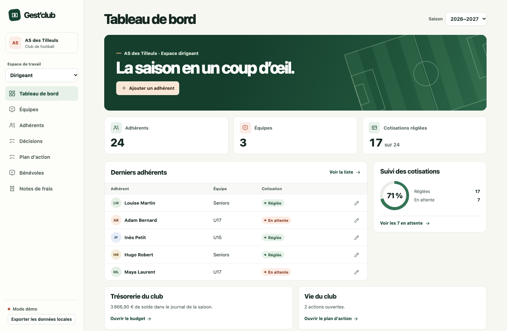

<h1 align="center">Gest’club</h1>

  <strong>Le tableau de bord open source des clubs sportifs amateurs.</strong> 
  Adhésions, vie du bureau et comptabilité, dans un espace commun accessible sur ordinateur et téléphone.

  <a href="#essayer-la-démo">Essayer la démo</a> ·
  <a href="docs/installation-ovh.md">Installer chez OVHcloud</a> ·
  <a href="sql/001-install.sql">Consulter le SQL</a> ·
  <a href="LICENSE">Licence MIT</a>

Chaque club héberge sa propre instance sur son compte OVHcloud et partage l’adresse HTTPS avec son bureau. Les membres se connectent avec leur compte et retrouvent les mêmes données depuis leurs appareils. Le dépôt GitHub contient le programme, le schéma et le guide. Les données du club sont stockées dans sa base PostgreSQL.

## Trois espaces pour le bureau

| Espace | Fonctionnalités |
| --- | --- |
| **Dirigeant** | Suivre les effectifs et les renouvellements, les échéances et les postes bénévoles. Relier une décision à une action et à une note de frais. |
| **Secrétaire** | Tenir le registre, importer les adhésions par CSV, reprendre la saison précédente et suivre les dossiers. Préparer les réunions et les AG, saisir présences, procurations et votes, puis exporter le PV. |
| **Trésorier** | Suivre les cotisations, factures et remboursements. Tenir la trésorerie, rapprocher les relevés, consulter les écritures et la balance, comparer le budget au réalisé et préparer le rapport financier d’AG. |

Une adhésion reprise par le secrétaire apparaît dans les effectifs du dirigeant et ouvre une cotisation à suivre chez le trésorier.

## Essayer la démo

[Télécharge le dépôt](https://github.com/julesmoreau62/gestclub/archive/refs/heads/main.zip), décompresse-le et ouvre **`index.html`** dans ton navigateur. Sélectionne un rôle dans **Espace de travail**. La démo contient un club fictif et conserve les modifications dans le navigateur. **Exporter les données locales** permet de récupérer une sauvegarde pour une future installation.

## Installer un espace club

Le guide détaille la configuration d’un hébergement Web OVHcloud avec **PHP 8.4** et d’une base **PostgreSQL managée**. Le club choisit son sous-domaine, initialise la base, crée les comptes du bureau puis vérifie l’accès depuis deux appareils. Le programme s’ouvre ensuite dans un navigateur.

**[Suivre le guide d’installation OVHcloud →](docs/installation-ovh.md)**

| Fichier | Rôle |
| --- | --- |
| [`index.html`](index.html) | Interface commune à la démo et à la version hébergée |
| [`sql/001-install.sql`](sql/001-install.sql) | Schéma PostgreSQL pour les comptes, les données de saison et les justificatifs |
| [`config.example.php`](config.example.php) | Modèle de configuration à copier et à renseigner sur l’hébergement du club |
| [`bin/gestclub.php`](bin/gestclub.php) | Initialisation, gestion des comptes et saisons, import et export |
| [`docs/installation-ovh.md`](docs/installation-ovh.md) | Installation, reprise des données et sauvegardes |

Gest’club est au **stade pilote**. Le schéma, les contrôles d’accès et la gestion des modifications concurrentes ont été vérifiés localement. La mise en service complète sur OVHcloud reste à valider sur une instance pilote.

Pour signaler un problème ou proposer une amélioration, [ouvre une issue](https://github.com/julesmoreau62/gestclub/issues). Le code est sous [licence MIT](LICENSE).
